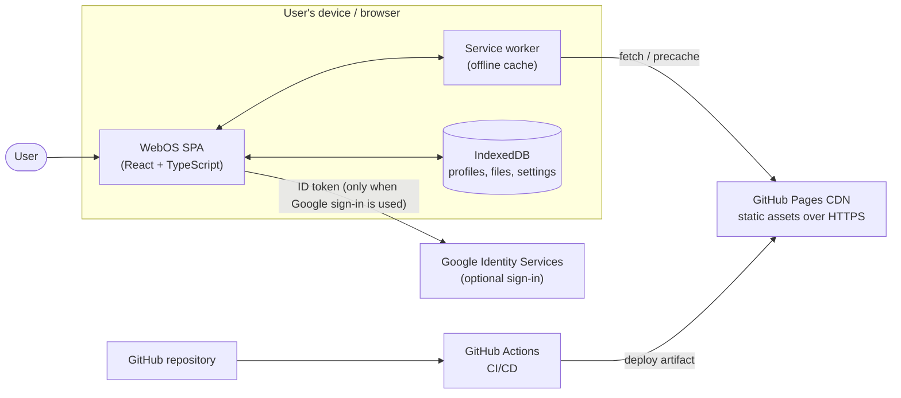
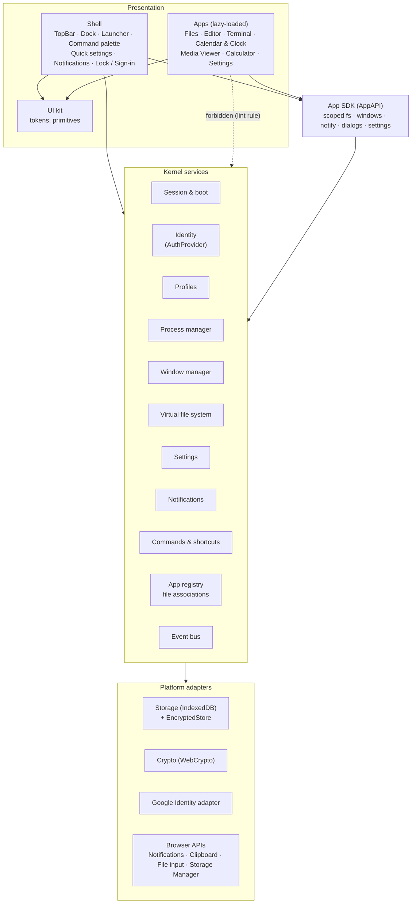
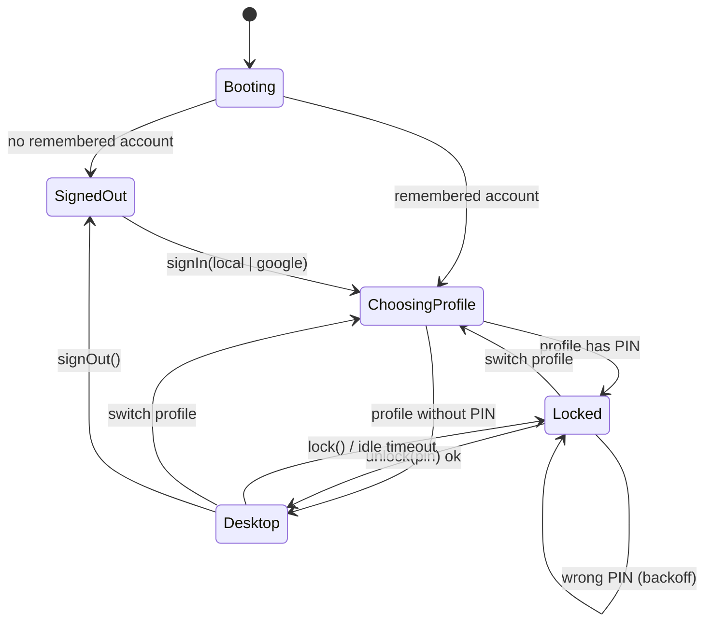
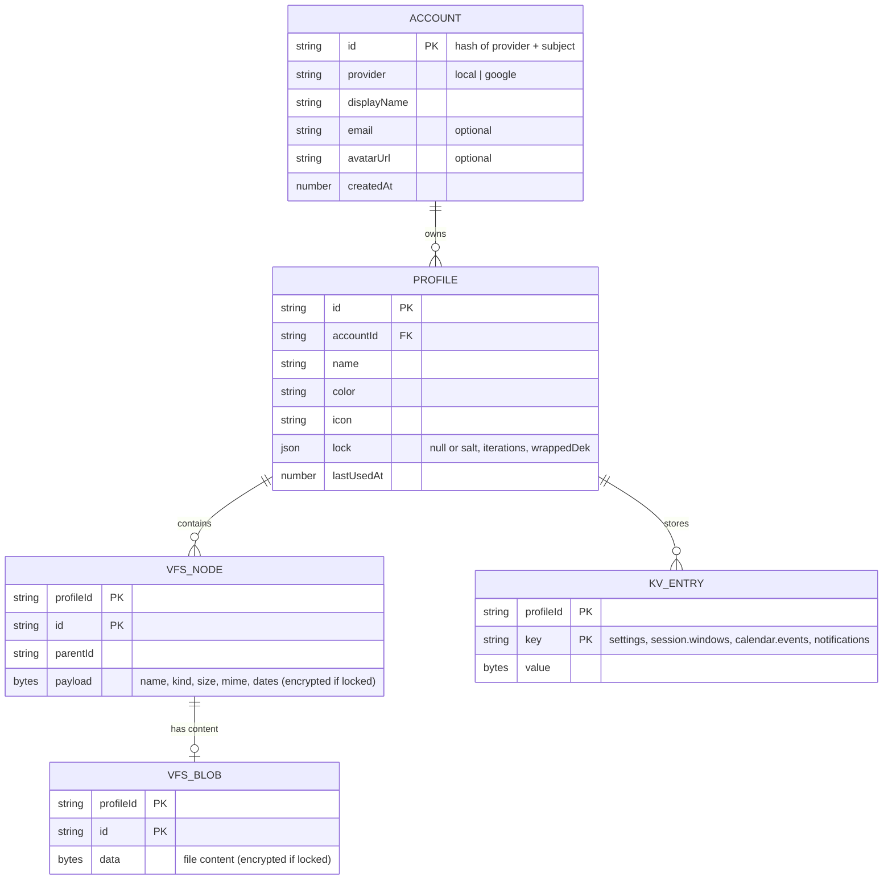
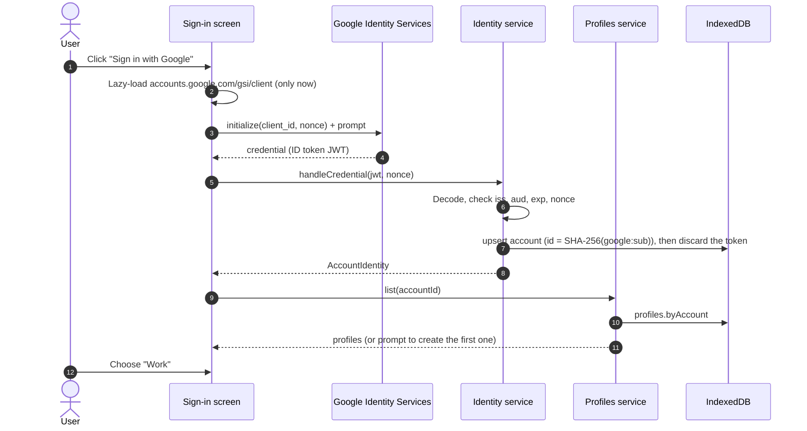
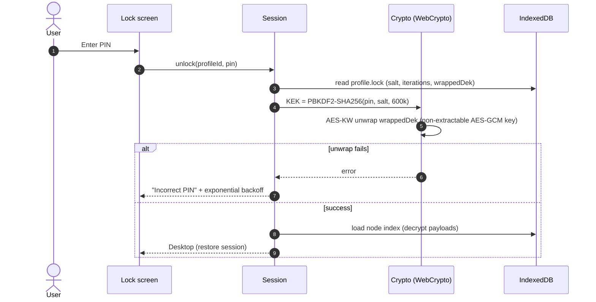
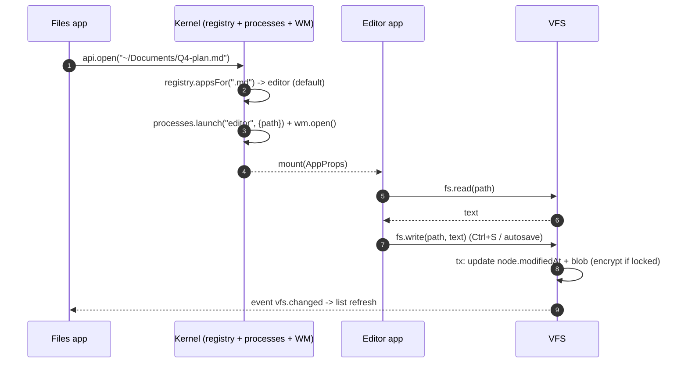

# WebOS architecture

> Status: **Approved for build (v1.0)**. Prototypes: [`docs/prototypes`](prototypes/README.md).
> Related: [Requirements](REQUIREMENTS.md) · [Security](SECURITY.md) · [Deployment](DEPLOYMENT.md) · [UX](UX.md) · [ADRs](adr/)

## 1. Overview

WebOS is a desktop environment that runs entirely in the browser: windowed apps, a virtual file system, multiple profiles, and an offline-capable shell. It's a **static single-page application** served from **GitHub Pages**. There's **no application server**: all logic runs on the client, and all user data stays in the user's browser.

| Goal | How the architecture delivers it |
|---|---|
| Host anywhere static (GitHub Pages) | Vite build to hashed static assets, relative `base`, no server routes, CSP in a `<meta>` tag |
| Intuitive, enterprise-grade UX | "Focus Shell" (top system bar + dock + command palette), design tokens, WCAG 2.2 AA |
| Private by default | No backend, no analytics; data in IndexedDB; optional per-profile encryption |
| Multiple profiles per sign-in | Account → Profiles hierarchy; every record is namespaced by `profileId` |
| Reliable and offline | Service worker precache, transactional storage, autosave, session restore |
| Maintainable | Strict TypeScript, layered modules with enforced import boundaries, unit + e2e tests |

### 1.1 Constraints

- **Static hosting only.** GitHub Pages serves files over HTTPS from a CDN. It can't run server code or set custom response headers. Its limits are 1 GB per site, a soft 100 GB/month of bandwidth, and 10 builds/hour.
- **Browser sandbox.** Storage is per-origin and subject to quota and eviction. Crypto goes through WebCrypto only.
- **Identity without a backend.** Only providers with a pure client-side flow can be used. Google Identity Services issues an ID token directly to the browser.
- **Target browsers:** last 2 versions of Chrome, Edge, Firefox and Safari (desktop and mobile).

## 2. System context



**Trust boundaries:**
- the browser origin, which holds all user data;
- GitHub (code, build, hosting);
- Google, for identity only.

No user content is sent to any server. See [SECURITY.md](SECURITY.md#3-trust-boundaries).

## 3. Container and layer view



### 3.1 Dependency rules
These are enforced by ESLint `no-restricted-imports` and `import/no-cycle`.

| Layer | May import | Must not import |
|---|---|---|
| `src/apps/**` | `src/sdk`, `src/ui`, `src/lib` | `src/kernel/**`, `src/shell/**`, other apps |
| `src/shell/**` | `src/kernel`, `src/sdk`, `src/ui`, `src/lib` | `src/apps/**` internals (only manifests via registry) |
| `src/sdk/**` | `src/kernel` (public `index.ts` only) | `src/shell`, `src/apps` |
| `src/kernel/**` | `src/platform`, `src/lib` | React, `src/shell`, `src/apps`, `src/ui` |
| `src/ui/**`, `src/lib/**` | nothing app-specific | kernel, shell, apps |

Keeping the kernel free of React makes it unit-testable in Node, with `fake-indexeddb` and WebCrypto from Node 22.

## 4. Kernel services

| Service | Responsibility | Key API (simplified) | Persistence |
|---|---|---|---|
| **Session** | Boot state machine; owns the current account/profile and the unlocked key | `boot()`, `signIn(provider)`, `selectProfile(id)`, `unlock(pin)`, `lock()`, `signOut()` | `meta` store (last account/profile) |
| **Identity** | Pluggable providers that turn a login into an `AccountIdentity` | `AuthProvider { id, isAvailable(), signIn(): AccountIdentity, signOut() }` | `accounts` store |
| **Profiles** | CRUD for profiles in an account; PIN set/change/remove; seed home folder | `list(accountId)`, `create(input)`, `update()`, `remove()`, `setPin()`, `verifyPin()` | `profiles` store |
| **Crypto** | Key derivation and record encryption | `deriveKek(pin, salt)`, `wrapDek()`, `unwrapDek()`, `encrypt(bytes)`, `decrypt(bytes)` | none (keys in memory only) |
| **Storage** | Typed, profile-scoped access to IndexedDB, with optional encryption decorator | `kv.get/set/delete`, `nodes.*`, `blobs.*`, `tx()` | IndexedDB `webos` |
| **VFS** | POSIX-like file tree per profile; Trash; quotas; watchers | `stat`, `list`, `read`, `write`, `mkdir`, `move`, `copy`, `trash`, `restore`, `remove`, `watch` | `nodes`, `blobs` |
| **Process manager** | Running app instances (pid), args, lifecycle hooks | `launch(appId, args)`, `kill(pid)`, `list()` | session snapshot |
| **Window manager** | Window geometry, state, focus, z-order, snapping, workspaces | `open()`, `focus()`, `move()`, `resize()`, `snap(zone)`, `minimize()`, `maximize()`, `close()` | `kv:session.windows` |
| **App registry** | Static manifests, categories, file-type associations | `get(appId)`, `all()`, `appsFor(mime/ext)` | build-time |
| **Commands** | Global command catalogue for palette and keyboard shortcuts | `register(cmd)`, `search(query)`, `run(id, args)` | user overrides in settings |
| **Notifications** | In-app notifications/toasts, DND, optional OS notifications | `notify(n)`, `dismiss(id)`, `setDnd(until)` | `kv:notifications` (last 50) |
| **Settings** | Versioned, schema-validated settings per profile | `get(key)`, `set(key, value)`, `subscribe()` | `kv:settings` |
| **Event bus** | Typed pub/sub between services | `on(type, fn)`, `emit(type, payload)` | none |

### 4.1 Boot and session state machine



Leaving `Desktop` for any reason does the following:
1. Asks running apps to persist (`beforeClose` hooks; unsaved editor buffers are saved as drafts).
2. Snapshots the window layout.
3. Kills all processes.
4. Zeroes the in-memory key reference.
5. Unmounts the desktop tree.

## 5. App model

Every app is a lazily loaded React component described by a static manifest:

```ts
// src/apps/editor/manifest.ts
export const manifest: AppManifest = {
  id: 'editor',
  name: 'Text Editor',
  icon: 'notebook-pen',
  color: ['#a78bfa', '#6d28d9'],
  category: 'productivity',
  keywords: ['notes', 'markdown', 'text'],
  fileTypes: ['.txt', '.md', '.json', '.csv', '.log'],
  window: { width: 760, height: 560, minWidth: 420, minHeight: 300 },
  singleInstance: false,
  load: () => import('./EditorApp'),
};
```

Each window receives `AppProps { pid, windowId, args, api: AppAPI }`. `AppAPI` is the **only** surface an app can use:

```ts
interface AppAPI {
  fs: ScopedFileSystem;          // read/write/list within the profile's VFS
  window: { setTitle(t: string): void; close(): void; onBeforeClose(fn: () => Promise<boolean>): void };
  notify(n: NotificationInput): void;
  dialogs: { openFile(opts?): Promise<Path | null>; saveFile(opts?): Promise<Path | null>; confirm(opts): Promise<boolean> };
  open(path: Path, opts?: { with?: AppId }): void;  // uses file associations
  settings: { get<T>(key: string): T; set<T>(key: string, v: T): void }; // app-scoped keys
  clipboard: { readText(): Promise<string>; writeText(t: string): Promise<void> };
}
```

**Lifecycle:**
1. `launch` creates a pid.
2. The window opens and the component loads (a suspense skeleton shows meanwhile).
3. The app mounts and the window gets focus/blur events.
4. On close, `onBeforeClose` runs and can veto the close (e.g., unsaved changes). Then the window unmounts and the pid is released.

**Isolation:**
- Each window is wrapped in an **error boundary**. A crash shows "*Editor stopped working · Restart · Close*" and is written to the local diagnostics log. The shell and other apps keep running.
- Apps are trusted first-party code in v1. Third-party apps are a later option: sandboxed `<iframe sandbox>` plus a `postMessage` SDK ([ADR-0001](adr/0001-client-only-static-architecture.md) § Future).

### 5.1 Built-in apps (v1)

| App | Highlights | Main SDK usage |
|---|---|---|
| Files | Sidebar locations, breadcrumb, list/grid, sort, multi-select, drag & drop, rename (F2), Trash/restore, upload/download, "Open with" | `fs`, `open`, `dialogs` |
| Text Editor | Tabs, Markdown toolbar, Edit/Split/Preview, find & replace, autosave drafts, line numbers, word count | `fs`, `window.onBeforeClose` |
| Terminal | Shell over the VFS: `help ls cd pwd cat echo (> >>) mkdir touch rm mv cp clear date whoami history open theme du about`; tab completion; history | `fs`, `open`, `settings` |
| Calendar & Clock | Month/week/agenda, local events with reminders; world clocks; timer/stopwatch (two launchers: Calendar, Clock) | `settings`, `notify` |
| Media Viewer | Images (PNG/JPEG/WebP/GIF/SVG via ``), zoom/rotate/fit, filmstrip, slideshow, set as wallpaper; sanitized Markdown preview | `fs`, `settings` |
| Calculator | Standard + scientific, keyboard input, history, copy result | `clipboard` |
| Settings | Appearance, Desktop & Dock, Notifications, Profiles & Account, Privacy & Security, Storage & Backup, Shortcuts, Accessibility, Language, About | kernel via shell bridge |

## 6. Window management

Window state lives in a Zustand store owned by the window manager:

```ts
type WindowState = {
  id: string; pid: number; appId: AppId; title: string; workspaceId: string;
  bounds: { x: number; y: number; w: number; h: number };
  mode: 'normal' | 'minimized' | 'maximized' | 'snapped';
  snap?: 'left' | 'right' | 'top-left' | 'top-right' | 'bottom-left' | 'bottom-right' | 'left-third' | 'center-third' | 'right-third';
  restoreBounds?: Bounds; z: number;
};
```

- **Drag and resize.** Pointer events with `setPointerCapture`. While dragging, a CSS `transform` updates inside `requestAnimationFrame`, and bounds are committed to the store on `pointerup` (no React re-render per frame). Each window has 8 resize handles and a minimum size from the manifest.
- **Snapping:**
  - Dragging to the left/right edge snaps to a half, a corner snaps to a quarter, and the top edge maximizes. A translucent preview shows the target.
  - Hovering the maximize button opens the *Snap layouts* flyout (halves, 2/3 + 1/3, thirds, quarters).
  - Keyboard: `Alt+←/→/↑/↓`.
  - The work area excludes the top bar (38 px) and dock reserve (88 px, or 0 when auto-hide is on), with 8 px gaps.
- **Focus and z-order.** Focusing a window brings it to the top. The focused window gets the strong shadow and an active dock indicator. `Alt+\`` cycles windows.
- **Workspaces.** Every window belongs to a workspace. The top bar switcher shows counts. Moving a window between workspaces is available from the context menu or `Ctrl+Alt+Shift+←/→`.
- **Session restore.** Per profile, open windows (appId, args, bounds, workspace) are saved, debounced, and restored after unlock (setting: *Restore apps on sign-in*).
- **Responsive mode (< 768 px).** Windows are always full-screen, the dock becomes bottom navigation, and the app switcher replaces overlapping windows.

## 7. Virtual file system (VFS)

- **Model.**
  - Each profile has a tree rooted at `/`, with seeded folders `/home/Desktop`, `/home/Documents`, `/home/Pictures`, `/home/Downloads` and a hidden `/trash`. The UI shows `/home` as `~`.
  - Nodes: `{ id, parentId, name, kind: 'file'|'dir', size, mime, createdAt, modifiedAt, starred?, trashedFrom? }`.
  - File content lives in a separate `blobs` store keyed by node id, so listings never load content.
- **In-memory index.** After unlock, the node table for the active profile is loaded into a `Map` (personal trees are small: typically < 10k nodes). Listing and search are O(children). Blobs load lazily.
- **Rules:**
  - Names are 1–255 characters, with no `/` or NUL and not `.` or `..`.
  - Names are unique case-insensitively within a folder.
  - Max depth is 32.
  - Max file size is 25 MB per file (configurable). The profile quota defaults to 2 GB and is shown against `navigator.storage.estimate()`.
- **Atomicity.** Each operation (e.g., `move` with conflict check, or `write` that updates node + blob) runs in a single IndexedDB transaction.
- **Trash.** `trash()` moves a node under `/trash` and records `trashedFrom`. `restore()` returns it, renaming on conflict as "name (2)". Emptying the Trash deletes the nodes and blobs.
- **Watchers.** `watch(path, cb)` is backed by the event bus (`vfs.changed`), so Files, Editor and Terminal stay in sync.
- **Import/export.** Files can be uploaded from the host via file input or drag & drop, and downloaded via `Blob` + `<a download>`. *Backup* exports a profile (manifest + nodes + blobs) to a single `.webos-backup.json`, which is zod-validated on import. If the profile is PIN-protected, the payload stays encrypted.

## 8. Data model and storage



**IndexedDB database `webos` (schema v1):**

| Object store | Key path | Indexes | Notes |
|---|---|---|---|
| `meta` | `key` | none | schema version, last account, install id |
| `accounts` | `id` | none | no tokens stored |
| `profiles` | `id` | `byAccount` (`accountId`) | lock material only (salt, wrapped key) |
| `nodes` | `[profileId, id]` | `byParent` (`[profileId, parentId]`) | `parentId` stays plaintext so the tree can be reconstructed; names and metadata go in the payload |
| `blobs` | `[profileId, id]` | none | file bytes |
| `kv` | `[profileId, key]` | none | settings, layout, calendar, notifications |

- **Migrations.** Migrations are versioned functions run inside `onupgradeneeded`, each covered by a unit test that upgrades a fixture DB from the previous version.
- **Persistence.** On first sign-in the app calls `navigator.storage.persist()` to reduce eviction risk, and Settings shows the result.
- **Encryption at rest.** When a profile has a PIN, an `EncryptedStore` decorator encrypts every `payload`/`data`/`value` with AES-GCM before it reaches IndexedDB. Key handling is described in [SECURITY.md § 6](SECURITY.md#6-cryptography-and-profile-pin).

## 9. Key flows

### 9.1 Sign in with Google and pick a profile



### 9.2 Unlock a PIN-protected profile



### 9.3 Open a file from Files in the Editor and save it



## 10. State management

- **Zustand stores** per domain: `sessionStore`, `windowStore`, `settingsStore`, `notificationStore`, `paletteStore`. Components subscribe through narrow selectors so a window drag doesn't re-render the dock.
- **Kernel is the source of truth.** Kernel services persist through the storage layer. The Zustand stores are reactive views and never write to `localStorage`.
- **Local component state** covers ephemeral UI such as an editor buffer before save or a hovered item.
- `localStorage` holds only non-sensitive UI hints needed before IndexedDB opens (e.g., `theme` to avoid a flash). Nothing personal goes there.

## 11. Error handling and resilience

| Failure | Behaviour |
|---|---|
| App throws during render | Window error boundary with Restart/Close; logged to diagnostics |
| Unhandled promise / `window.onerror` | Toast "Something went wrong" with details in Settings → About → Diagnostics (ring buffer of 200 entries, local only) |
| `QuotaExceededError` | Write is rolled back; toast with "Free up space" → Storage page; app stays usable read-only for that file |
| IndexedDB unavailable (rare private modes) | In-memory fallback session with a persistent banner: "Changes won't be saved" |
| Schema migration fails | Transaction aborts; DB left at previous version; user offered "Export backup" before retry |
| Service-worker update available | Non-blocking toast "Update ready, Reload"; never auto-reloads with unsaved work |
| Tab closed with unsaved edits | `beforeunload` prompt + editor drafts autosaved every 2 s |

## 12. Performance design

- **Budgets**, enforced in CI by `scripts/check-bundle-size.mjs`:
  - shell entry ≤ 150 KB gzipped;
  - each app chunk ≤ 60 KB gzipped (the Markdown renderer is shared, ≤ 45 KB);
  - total precache ≤ 1.5 MB.
- **Code splitting.** Every app and the command palette's search index are separate chunks. Likely-next apps are prefetched on dock hover.
- **Rendering:**
  - `contain: layout paint` on windows;
  - transform-based drag;
  - virtualized lists in Files above 200 rows;
  - `content-visibility: auto` for long Markdown previews.
- **Main-thread hygiene.** PBKDF2 and AES run in WebCrypto, which is off the main thread. Heavy search indexing uses `requestIdleCallback`.
- **Startup.** Self-hosted fonts (Inter, JetBrains Mono, subset WOFF2) with `font-display: swap`. Wallpapers are CSS/SVG (bytes, not megabytes).

## 13. Offline and updates (PWA)

- `vite-plugin-pwa` (Workbox) precaches the app shell, app chunks, fonts and icons.
- `registerType: 'prompt'`. A new service worker waits until the user accepts the *Update ready* toast.
- The web app manifest makes WebOS installable (standalone display, maskable icons). The Pages path is handled with `start_url: './'` and `scope: './'`.

## 14. Accessibility architecture

- **Landmarks:**
  - top bar = `banner`;
  - dock = `navigation` ("Dock");
  - each window = `region` labelled by its title (`role="dialog"` for modal dialogs only).
- **Focus management:**
  - opening a window focuses its first interactive element;
  - closing returns focus to the invoker;
  - palette, launcher and menus use focus traps and roving `tabindex`;
  - `F6` cycles between top bar, desktop/windows and dock.
- **Announcer.** A polite `aria-live` region announces window open/close, snap results and notifications.
- **Preferences.** `prefers-reduced-motion`, `prefers-contrast`, `prefers-color-scheme` and `forced-colors` are honoured. Text size scales via a root `font-size` multiplier.
- **Testing.** `@axe-core/playwright` runs in e2e for every primary screen, plus keyboard-only e2e journeys.

## 15. Internationalisation

- All user-facing strings go through `t('key')` with an `en-US` catalogue. Catalogues are JSON loaded on demand.
- Dates, times, numbers and file sizes use `Intl.*` with the profile's locale setting. Calendars start on the locale's first day of the week (`Intl.Locale#weekInfo` where available).
- Layout uses logical CSS properties so RTL locales can be added later.

## 16. Technology stack

| Concern | Choice | Rationale |
|---|---|---|
| Language | TypeScript (strict, `noUncheckedIndexedAccess`) | Type safety across kernel/SDK boundary |
| UI | React 19 | Ubiquitous, strong a11y ecosystem, concurrent rendering |
| Build | Vite | Fast dev server, code splitting, static output |
| State | Zustand | Tiny, selector-based, works outside React (kernel) |
| Storage | IndexedDB via `idb` | Structured, transactional, large quota |
| Crypto | WebCrypto (PBKDF2, AES-KW, AES-GCM) | Native, audited, non-extractable keys |
| Validation | zod | Settings and backup import schemas |
| Markdown | `marked` + `DOMPurify` | Small, fast; sanitized output |
| Icons / fonts | Lucide, Inter, JetBrains Mono (self-hosted) | Consistent, permissive licenses, no third-party requests |
| PWA | `vite-plugin-pwa` (Workbox) | Precache + update prompt |
| Tests | Vitest, Testing Library, `fake-indexeddb`, Playwright, axe-core | Unit, component, e2e, a11y |
| Quality | ESLint (typescript-eslint, react-hooks, jsx-a11y, import), Prettier | Consistency, boundary enforcement |
| CI/CD | GitHub Actions → GitHub Pages | Native to the repo, OIDC-based deploy |

## 17. Repository layout

```
.github/            workflows (ci, deploy, codeql), dependabot, PR template
docs/               architecture, requirements, security, deployment, UX, ADRs, prototypes
public/             manifest, icons, sample images, wallpapers
scripts/            prototype rendering, docs checks, bundle-size check
src/
  app/              boot + top-level providers
  kernel/           services (no React)
  platform/         IndexedDB, WebCrypto, Google Identity adapters
  sdk/              AppAPI given to apps
  shell/            desktop chrome (top bar, dock, windows, overlays)
  apps/<id>/        manifest.ts + lazy entry
  ui/               design-system primitives
  styles/           tokens.css, globals
  lib/              pure utilities (paths, format, i18n)
tests/
  unit/             cross-module unit tests (others colocated as *.test.ts)
  e2e/              Playwright specs (+ axe)
```

## 18. Testing strategy

| Level | Tooling | Scope | Gate |
|---|---|---|---|
| Unit | Vitest + `fake-indexeddb` + Node WebCrypto | Kernel services, VFS rules, crypto round-trips, terminal parser, calculator engine, snapping math, migrations | ≥ 80 % line coverage on `src/kernel`, `src/lib` |
| Component | Vitest + Testing Library (jsdom) | UI primitives, shell widgets, app views with a fake `AppAPI` | Required for new components |
| End-to-end | Playwright (Chromium in CI; Firefox/WebKit nightly) | User journeys in [REQUIREMENTS § 6](REQUIREMENTS.md#6-traceability) | All green before merge |
| Accessibility | `@axe-core/playwright` + keyboard journeys | Every primary screen, light + dark | 0 serious/critical violations |
| Visual | Playwright screenshots | Shell + each app at 1440×900 and 390×844 | Reviewed in PR (attached to PR description) |
| Performance | Bundle-size script; Lighthouse CI (optional) | Budgets in § 12 | Fails CI when exceeded |
| Security | CodeQL, `npm audit --omit=dev`, Dependabot | Code + dependencies | No high/critical findings |

## 19. Observability

- No analytics and no remote logging by default. That's a privacy requirement, see NFR-PRIV-01.
- The local diagnostics log is viewable and exportable in Settings → About → Diagnostics. It records app crashes, unhandled errors, storage failures and timings for boot/unlock.
- Build metadata (`VITE_APP_VERSION`, `VITE_BUILD_SHA`, build time) appears in About and in the console banner, to make support easier.
