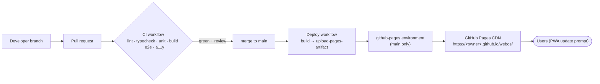

# Deploying WebOS to GitHub Pages

> Related: [Architecture](ARCHITECTURE.md) · [Security](SECURITY.md) · [Requirements](REQUIREMENTS.md)

WebOS is a static site, so deploying it means **building assets and publishing them to GitHub Pages** through GitHub Actions. No servers, databases or secrets are involved.

## 1. Pipeline overview



| Environment | URL | How it's produced |
|---|---|---|
| Local development | `http://localhost:5173` | `npm run dev` (Vite dev server, HMR) |
| Local production preview | `http://localhost:4173` | `npm run build && npm run preview` |
| CI (every PR) | none (artifact) | `ci.yml` builds, runs unit + e2e against `vite preview`, and uploads the Playwright report |
| **Production** | `https://yesoreyeram.github.io/webos/` | `deploy.yml` on every push to `main`, or a manual run |

> **Current state (Phase 1).** Until the application lands, `deploy.yml` publishes the **prototype gallery** (`docs/prototypes/`), so stakeholders can review the designs at the production URL. The build-the-app step replaces this in the scaffold PR. The workflow shape and setup steps don't change.

## 2. One-time repository setup

1. **Enable Pages with Actions.** In **Settings → Pages → Build and deployment → Source**, choose **GitHub Actions**.
2. **Protect the deployment environment.** Under **Settings → Environments → `github-pages`** (created on first deploy), set *Deployment branches and tags* to **Selected branches: `main`**.
3. **Protect `main`.** In **Settings → Branches → Add rule** for `main`, require a pull request with ≥ 1 approval, require the status checks `CI / verify` and `CodeQL`, and block force pushes.
4. **Security features.** In **Settings → Code security**, enable Dependabot alerts and security updates, secret scanning with push protection, and private vulnerability reporting.
5. **Optional: Google sign-in.** Follow § 4.

## 3. Deploying

- **Automatic.** Merge a PR into `main`. The **Deploy to GitHub Pages** workflow builds and publishes it in about 1–2 minutes. The page URL appears in the workflow summary and under **Settings → Pages**.
- **Manual.** Go to **Actions → Deploy to GitHub Pages → Run workflow**, choose branch `main`, and run it.
- **Verify** (smoke test, about 2 minutes):
  1. Open the site in a private window. The sign-in screen renders with no console errors.
  2. Create a local account, then a profile, then open Files, Editor and Terminal.
  3. Check **Settings → About**: the version and commit SHA should match the merged commit.
  4. In DevTools, open **Application → Service Workers** and confirm the worker is activated. Go offline and reload: the app still boots.

### 3.1 Workflow reference

The production workflow is [`.github/workflows/deploy.yml`](../.github/workflows/deploy.yml). Once the app exists, its build job looks like this:

```yaml
name: Deploy to GitHub Pages
on:
  push:
    branches: [main]
  workflow_dispatch:
permissions:
  contents: read
concurrency:
  group: pages
  cancel-in-progress: false
jobs:
  build:
    runs-on: ubuntu-latest
    steps:
      - uses: actions/checkout@v7
        with: { persist-credentials: false }
      - uses: actions/setup-node@v4
        with: { node-version: 22, cache: npm }
      - run: npm ci
      - run: npm run build
        env:
          VITE_GOOGLE_CLIENT_ID: ${{ vars.GOOGLE_CLIENT_ID }}
          VITE_BUILD_SHA: ${{ github.sha }}
      - uses: actions/configure-pages@v6
      - uses: actions/upload-pages-artifact@v5
        with: { path: dist }
  deploy:
    needs: build
    runs-on: ubuntu-latest
    permissions:
      pages: write
      id-token: write
    environment:
      name: github-pages
      url: ${{ steps.deployment.outputs.page_url }}
    steps:
      - id: deployment
        uses: actions/deploy-pages@v4
```

### 3.2 Build-time configuration

| Variable | Source | Default | Purpose |
|---|---|---|---|
| `VITE_GOOGLE_CLIENT_ID` | Repo **variable** `GOOGLE_CLIENT_ID` | empty | Enables *Sign in with Google* and adds Google origins to the CSP. Empty means local accounts only |
| `VITE_BUILD_SHA` | `github.sha` | `dev` | Shown in Settings → About and the console banner |
| `VITE_APP_VERSION` | `package.json` `version` | none | Shown in About; used for update notes |
| Vite `base` | `vite.config.ts` | `'./'` | Relative asset URLs, so the build works under `/webos/`, any repo name or a custom domain |

WebOS has no client-side router (navigation is window-based), so no `404.html` SPA fallback is needed.

## 4. Enabling Google sign-in (optional)

1. In [Google Cloud Console](https://console.cloud.google.com/), create or select a project.
2. Go to **APIs & Services → OAuth consent screen**. Choose *External*, enter the app name **WebOS**, a support email and the scopes `openid`, `email` and `profile` (the defaults), then publish.
3. Go to **APIs & Services → Credentials → Create credentials → OAuth client ID**:
   - **Application type:** Web application.
   - **Authorized JavaScript origins:** `https://yesoreyeram.github.io`, `http://localhost:5173` and `http://localhost:4173` (plus your custom domain, if any).
   - **Authorized redirect URIs:** leave empty. The GIS popup/FedCM flow doesn't use them.
4. Copy the **Client ID** (`…apps.googleusercontent.com`). It's public by design.
5. In GitHub, go to **Settings → Secrets and variables → Actions → Variables → New repository variable** and add `GOOGLE_CLIENT_ID` with that value.
6. Re-run **Deploy to GitHub Pages**. The sign-in screen now shows *Sign in with Google*.

For local development, put `VITE_GOOGLE_CLIENT_ID=…` in `.env.local` (git-ignored).

## 5. Caching, offline and updates

- Vite emits **content-hashed** filenames, so assets are effectively immutable. `index.html`, `manifest.webmanifest` and `sw.js` aren't hashed.
- GitHub Pages applies a short cache lifetime (about 10 minutes) to all files. Browsers also re-check the service worker script on navigation, at least every 24 h.
- The service worker (Workbox, `registerType: 'prompt'`) precaches the new version in the background and shows an **"Update ready, Reload"** toast. It never reloads automatically while there's unsaved work.
- **Users' data isn't affected by deployments.** It lives in their browser's IndexedDB. Schema migrations run on first load of a new version (see [ARCHITECTURE § 8](ARCHITECTURE.md#8-data-model-and-storage)).

## 6. Rollback

| Situation | Action |
|---|---|
| Bad release, `main` still healthy after a revert | `git revert` the offending merge on `main`. The Deploy workflow republishes automatically |
| Need the previous build right now | **Actions → Deploy to GitHub Pages**, open the last good run, then **Re-run all jobs** |
| Compromised build (security) | Do one of the above, then follow [SECURITY § 10](SECURITY.md#10-incident-response). Clients pick up the fixed service worker on next navigation |

## 7. Custom domain and HTTPS

1. Go to **Settings → Pages → Custom domain**, enter e.g. `webos.example.com` and save. GitHub commits a `CNAME` file for Actions-based sites, or you add it to the artifact.
2. **DNS:** add a `CNAME` record from `webos.example.com` to `yesoreyeram.github.io`. For an apex domain, add `A`/`AAAA` records to GitHub Pages IPs as documented by GitHub.
3. Tick **Enforce HTTPS** once the certificate is issued.
4. Add the new origin to the Google OAuth client's **Authorized JavaScript origins**.
5. **Optional hardening.** Put a CDN such as Cloudflare in front to add response headers that GitHub Pages can't set: `Strict-Transport-Security`, `Content-Security-Policy` with `frame-ancestors 'none'`, `Permissions-Policy`, `X-Content-Type-Options`, `Cross-Origin-Opener-Policy`.

## 8. Other static hosts

`dist/` is portable. It also runs on Netlify, Cloudflare Pages, Azure Static Web Apps, Vercel or S3 + CloudFront. Those platforms can set headers natively; mirror the CSP in [SECURITY § 5](SECURITY.md#5-content-security-policy-and-browser-hardening) and add `frame-ancestors 'none'`.

## 9. GitHub Pages limits

| Limit | Value | WebOS footprint |
|---|---|---|
| Published site size | 1 GB | ~2 MB |
| Bandwidth | ~100 GB/month (soft) | Fine for typical use; assets are cached by the service worker |
| Builds | 10 per hour (soft) | One per merge |
| Server code / headers | Not supported | Not needed (client-only design; CSP via meta tag) |

## 10. Troubleshooting

| Symptom | Likely cause | Fix |
|---|---|---|
| Blank page, 404s for `/assets/*.js` | Absolute `base` in Vite config | Keep `base: './'` |
| Workflow fails at *Deploy*: "Pages not enabled" / 404 | Pages source not set to Actions | § 2 step 1 |
| Deploy blocked: "Branch is not allowed to deploy" | Environment protection rules | Allow `main` in the `github-pages` environment |
| *Sign in with Google* missing | `GOOGLE_CLIENT_ID` variable not set, or the build ran before it was added | Set the variable and re-run Deploy |
| Google popup error `origin_mismatch` | Site origin not in *Authorized JavaScript origins* | Add the exact origin (scheme + host, no path) |
| Console shows CSP violations | A new external resource was added | Self-host it or update the CSP (security review required) |
| Users still see the old version | Waiting service worker | Click **Reload** in the update toast, or close all tabs |
| Data "disappeared" | Different origin (custom domain vs github.io) or browser storage cleared | Data is per origin. Use Settings → Storage & Backup to export and import |

## 11. Releases and versioning

- **Semantic Versioning.** `MAJOR.MINOR.PATCH` lives in `package.json`.
- **Release process.** Bump the version in a PR, then merge. Tag `vX.Y.Z` on `main` and create a **GitHub Release** with notes (features, fixes, migrations, security).
- **Changelog.** The *Release notes* section of each PR feeds the release notes.
