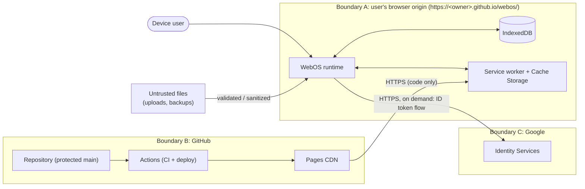

# WebOS security architecture

> Scope: the WebOS client application, its build pipeline and its hosting on GitHub Pages.
> To report a vulnerability, see the repository [security policy](../SECURITY.md).
> Related: [Architecture](ARCHITECTURE.md) · [Requirements](REQUIREMENTS.md) · [Deployment](DEPLOYMENT.md)

## 1. Security goals

1. **Confidentiality of user data on shared devices.** One profile's data can't be read from another profile. A PIN- or passphrase-protected profile can't be read without its secret.
2. **Integrity of the application.** The code users run is the code reviewed and merged on `main`.
3. **No data leaves the device.** No analytics, no remote storage. The only external call is optional Google sign-in.
4. **Resilience to untrusted content.** Files users import (Markdown, SVG, images, text) can't execute script.
5. **Honest guarantees.** Limitations of a client-only design are documented ([§ 11](#11-known-limitations-and-residual-risks)).

## 2. Assets

| Asset | Where | Sensitivity |
|---|---|---|
| File contents, names and metadata | IndexedDB `nodes`, `blobs` | High (user content) |
| Settings, calendar events, window layout | IndexedDB `kv` | Medium |
| Account identity (Google `sub`, name, email, avatar URL) | IndexedDB `accounts` | Medium (PII) |
| Profile lock material (salt, wrapped DEK) | IndexedDB `profiles` | High (attack target) |
| Unwrapped data key | Memory only (non-extractable `CryptoKey`) | Critical |
| Application code | GitHub repo → Actions → Pages CDN → service worker cache | Critical (integrity) |
| Google OAuth client ID | Build-time variable (public by design) | Low |

## 3. Trust boundaries



- **A**: everything inside the origin is trusted to the extent the code is trusted. Anyone with OS-level access to the browser profile can read unencrypted IndexedDB data.
- **B**: code integrity depends on GitHub account security, branch protection and the CI/CD configuration.
- **C**: Google is trusted only to assert identity. It never receives user content.

## 4. Threat model (STRIDE)

| # | Threat | Example | Mitigations | Residual |
|---|---|---|---|---|
| S1 | **Spoofing** a profile on a shared device | Another person opens the browser and selects Jordan's *Work* profile | Per-profile PIN/passphrase with encryption at rest; auto-lock on idle (default 10 min); manual lock `Ctrl+Alt+L`; lock on sign-out | Profiles **without** a PIN are open to anyone with device access (by design, shown in UI) |
| S2 | Spoofing a Google identity | Forged ID token to attach to another user's account record | Validate `iss`, `aud`, `exp`, `nonce`; account id = SHA-256(`google:` + `sub`); token used only for local identification, never for remote authorization | Client-side validation can be bypassed by someone controlling the device, but they already have device access (see S1) |
| T1 | **Tampering** with stored data | Editing IndexedDB records via DevTools | AES-GCM authenticated encryption with AAD = `profileId‖store‖recordId` (detects modification and record swapping) on protected profiles; zod validation of decrypted payloads | Unprotected profiles can be modified by the device user |
| T2 | Tampering with the app (supply chain) | Malicious dependency or compromised workflow | Lockfile + `npm ci`; Dependabot; CodeQL; `npm audit`; least-privilege workflow `permissions`; deploy only from `main` via the `github-pages` environment; branch protection + required reviews; secret scanning with push protection | Compromise of a maintainer's GitHub account |
| R1 | **Repudiation** | N/A: single-user local app | Local diagnostics log (user-visible, exportable) | None |
| I1 | **Information disclosure** via XSS | Malicious Markdown file exfiltrates data | Strict CSP (§ 5): no inline/eval script, `connect-src` limited to self + GIS; DOMPurify on all rendered HTML; SVG only via ``; no `dangerouslySetInnerHTML` outside the sanitizer wrapper (lint rule); remote images blocked in Markdown preview | Zero-day in browser or sanitizer |
| I2 | Disclosure via third parties | Analytics, CDN fonts, referrers | No analytics; self-hosted fonts/icons; GIS script loaded only on demand; `referrer` meta `strict-origin-when-cross-origin` | Google learns that a sign-in happened (inherent) |
| I3 | Disclosure on lock screen / notifications | Event titles visible while locked | Setting *Show notification content when locked* (default **off** for PIN profiles) | User choice |
| I4 | Disclosure through backups | Backup file shared accidentally | Backups of protected profiles remain encrypted; export shows a warning for unprotected profiles | User choice |
| D1 | **Denial of service** | Huge upload fills quota; pathological Markdown | Per-file limit (25 MB), profile quota (2 GB), preview size cap (1 MB), transactional writes, error boundaries | Browser may still evict data under storage pressure (we request persistence) |
| E1 | **Elevation of privilege** across profiles/apps | App reads another profile's files | Kernel scopes every storage call by the active `profileId`; apps only receive `AppAPI` (no kernel imports, lint-enforced); future third-party apps run in sandboxed iframes | First-party app bugs (mitigated by tests and review) |
| E2 | Clickjacking | Site embeds WebOS in an iframe and overlays UI | Frame-busting guard (`if (top !== self)`, render a warning and stop booting), because `frame-ancestors` is ignored in meta CSP | Old browsers with JS disabled (app can't run anyway) |

## 5. Content Security Policy and browser hardening

GitHub Pages can't set response headers, so the policy is delivered with `<meta http-equiv="Content-Security-Policy">` in `index.html`:

```text
default-src 'self';
script-src 'self' https://accounts.google.com/gsi/client;
style-src 'self' https://accounts.google.com/gsi/style;
img-src 'self' data: blob: https://*.googleusercontent.com;
font-src 'self';
connect-src 'self' https://accounts.google.com/gsi/;
frame-src https://accounts.google.com/gsi/;
worker-src 'self';
manifest-src 'self';
object-src 'none';
base-uri 'self';
form-action 'none';
upgrade-insecure-requests
```

- **No `'unsafe-inline'` or `'unsafe-eval'`.** Vite emits external, hashed JS and CSS. React's `style={…}` assignments go through the CSSOM, which CSP doesn't block.
- **Google origins are added only when Google sign-in is enabled.** If `VITE_GOOGLE_CLIENT_ID` is empty at build time, the Vite HTML transform drops them.
- **Not available through a meta tag:** `frame-ancestors`, `report-uri`/`report-to` and `sandbox`. Clickjacking is handled by the frame guard (E2). CSP violations are caught by a `securitypolicyviolation` listener that writes to the local diagnostics log, and e2e tests fail on any violation.
- **Other meta tags:** `<meta name="referrer" content="strict-origin-when-cross-origin">`, plus `color-scheme`.
- **Stricter headers.** If you need HSTS preload, `Permissions-Policy`, COOP/COEP or `X-Frame-Options`, put a proxy that adds headers (e.g., Cloudflare) in front of Pages, or use another static host. The app works unchanged. See [DEPLOYMENT § 7](DEPLOYMENT.md#7-custom-domain-and-https).
- **Trusted Types** (`require-trusted-types-for 'script'`) is planned once GIS compatibility is verified.

## 6. Cryptography and profile PIN

The goal is to encrypt the data of a protected profile at rest, unlockable only with the user's secret.

| Item | Choice |
|---|---|
| Secret | PIN (4–12 digits) or passphrase (≥ 8 chars). Passphrase is recommended for sensitive data |
| KDF | PBKDF2-HMAC-SHA-256, **600,000** iterations (OWASP 2023+), 16-byte random salt per profile |
| Key-encryption key (KEK) | AES-KW 256, derived by the KDF; never stored |
| Data-encryption key (DEK) | AES-GCM 256, random (`crypto.subtle.generateKey`), stored only **wrapped** by the KEK |
| Record encryption | AES-GCM with a 96-bit random IV per write; AAD = `profileId ‖ store ‖ recordId ‖ schemaVersion` |
| Stored per profile | `{ v, kdf: 'PBKDF2-SHA256', iterations, salt, wrappedDek }` |
| PIN verification | Successful AES-KW unwrap (built-in integrity check). No separate PIN hash is stored |
| In memory | DEK imported as **non-extractable** `CryptoKey`; references dropped on lock/sign-out/idle |

**Flows:**
- **Set PIN.** Generate a DEK, derive the KEK, wrap the DEK, then re-encrypt all records in batched transactions, with a progress UI and resume on interruption.
- **Change PIN.** Unwrap with the old KEK and re-wrap with the new one. No data re-encryption is needed.
- **Remove PIN.** Verify, decrypt all records, then delete the lock material.
- **Rotate key.** The *Re-encrypt profile* action generates a new DEK and re-encrypts everything.
- **Brute-force friction.** The UI applies exponential backoff after 5 failures. This is a UX control only: an attacker with a copy of the database can attempt offline guesses. That's why passphrases are offered and recommended, and why the iteration count is high.
- **Forgotten PIN.** The data can't be recovered. This is stated clearly when setting a PIN, along with a nudge to export a backup.

## 7. Authentication (Google Identity Services)

- Uses the **Sign in with Google** button or One Tap through FedCM where supported. The GIS script is lazy-loaded only on the sign-in screen and only if a client ID is configured.
- A random `nonce` is generated per attempt, kept in memory, passed to `initialize`, and compared against the token's `nonce` claim.
- **Validation:** `iss ∈ {accounts.google.com, https://accounts.google.com}`, `aud === VITE_GOOGLE_CLIENT_ID`, `exp > now − 60s`, `nonce` matches. Optionally, the RS256 signature is checked against Google's JWKS with WebCrypto when reachable (defense in depth, since no server relies on the token).
- **Data minimization.** WebOS keeps only `sub` (hashed into the account id), `name`, `email` and `picture`. The JWT is discarded right after validation, and no access or refresh tokens are ever requested.
- **Access control.** Google sign-in **identifies** an account. It doesn't encrypt data. On a shared device, access control is provided by the profile PIN/passphrase (S1).
- **Sign-out** calls `google.accounts.id.disableAutoSelect()` and clears in-memory session state.

## 8. Handling untrusted content

| Content | Handling |
|---|---|
| Markdown (Editor preview, Media Viewer) | `marked` (no raw HTML passthrough) → DOMPurify with an allow-list (no `style`, no event handlers, no `iframe/object/embed/form`), `javascript:` and `data:` links removed (except `data:image/*` for images); external images replaced by a placeholder ("Remote images blocked") |
| SVG | Displayed only via ``, which doesn't execute scripts. Never inlined into the DOM |
| HTML files | Shown as source text only |
| Text/CSV/JSON | Rendered as text (React escapes by default) |
| Uploaded files | Size-checked, MIME sniffed from extension + magic bytes, stored as `Blob` |
| Backup import | Size limit, JSON parse in try/catch, **zod** schema validation, version check; imported as a new profile (never merges into an existing one) |
| Clipboard | Text only; no HTML paste into rich contexts |

## 9. Secure development lifecycle

- **Branch protection on `main`:** PRs required; ≥ 1 review; required checks (`ci`, `codeql`); linear history; no force pushes.
- **Workflows:**
  - top-level `permissions: contents: read`; deploy job adds only `pages: write` and `id-token: write`;
  - `actions/checkout` with `persist-credentials: false`;
  - third-party actions pinned (SHA pinning recommended, kept current by Dependabot);
  - deploy uses the `github-pages` environment restricted to `main`.
- **Dependencies:** minimal runtime set (see [ARCHITECTURE § 16](ARCHITECTURE.md#16-technology-stack)); Dependabot weekly for npm and Actions; `npm audit --omit=dev --audit-level=high` in CI.
- **Static analysis:** TypeScript strict; ESLint security-relevant rules (`no-eval`, `no-implied-eval`, `react/no-danger` with a single allow-listed wrapper); CodeQL `javascript-typescript`.
- **Secrets:** none needed at runtime. The Google client ID is a public *variable*, not a secret. Secret scanning and push protection are enabled on the repo.
- **Review checklist:** every PR description includes screenshots, unit and e2e test evidence, and deployment notes (see `.github/pull_request_template.md`).

## 10. Incident response

1. **Intake.** Private vulnerability report via GitHub Security Advisories ([policy](../SECURITY.md)). Acknowledge within 3 business days.
2. **Triage.** Assess severity (CVSS) and affected versions.
3. **Contain.**
   - If a malicious or broken build was deployed, re-run the last known-good **Deploy** workflow (or revert on `main`). The service worker is re-checked by browsers on navigation, at least every 24 h, so clients pick up the fix. The update toast prompts an immediate reload.
4. **Fix and release.** Patch with a test, publish a GitHub Release with notes, then publish the advisory.
5. **Post-mortem.** Add regression tests and update this document.

## 11. Known limitations and residual risks

- **Client-only trust.** Anyone with access to the OS user account and browser profile can read **unprotected** profiles, and can attempt offline guessing against protected ones.
- **Browser storage can be evicted** under storage pressure or cleared by the user. Persistence is requested, the status is shown, and backups are encouraged.
- **JavaScript can't securely wipe memory.** Keys are non-extractable and references are dropped, but copies may linger until garbage collection.
- **No cross-device sync.** Moving data requires export/import.
- **Header-based protections** (HSTS preload, COOP/COEP, `frame-ancestors`) can't be set on GitHub Pages without a proxy (see § 5).
- **Google sign-in depends on third-party availability.** Local accounts keep working offline.
