# WebOS prototypes

High-fidelity prototypes of the **Focus Shell** design. Each PNG is rendered from the HTML/CSS source in [`src/`](src/), which uses the same design tokens the app will use ([UX.md](../UX.md)).

- **Regenerate:** `npm run prototypes:render`, or `npm run prototypes:render -- 05-desktop-multitasking` for one screen.
- **Icon sprite:** `npm run prototypes:icons` (icons from [Lucide](https://lucide.dev), ISC license).
- **Live gallery:** published to GitHub Pages by the deploy workflow (see [DEPLOYMENT.md](../DEPLOYMENT.md)).

| # | Screen | What it shows |
|---|---|---|
| 01 | [Sign in](01-sign-in.png) | Remembered accounts, Google sign-in, local account, privacy note |
| 02 | [Profile picker](02-profile-picker.png) | One Google account, three profiles (two PIN-encrypted), add profile |
| 03 | [Lock screen](03-lock-screen.png) | PIN entry with keypad, switch profile, upcoming event |
| 04 | [Desktop (first run)](04-desktop-empty.png) | Focus Shell, *Get started* checklist, Today widgets, dock tooltip |
| 05 | [Multitasking](05-desktop-multitasking.png) | Files + Text Editor snapped side by side, Snap layouts flyout |
| 06 | [Command palette](06-command-palette.png) | Grouped results, scope chips, keyboard hints |
| 07 | [Launcher](07-launcher.png) | Pinned/more apps, quick actions, recent files, profile actions |
| 08 | [Quick settings + notifications](08-quick-settings-notifications.png) | Toggles, accent, text size, storage, profile; actionable notifications |
| 09 | [Settings](09-settings-app.png) | Appearance: theme, accent, wallpaper, transparency, motion |
| 10 | [Terminal + Calendar](10-terminal-calendar.png) | VFS shell with completion; month view, agenda, world clock |
| 11 | [Media viewer](11-media-viewer.png) | Image viewer with details and filmstrip; sanitized Markdown preview |
| 12 | [Dark mode](12-desktop-dark.png) | Screen 05 in the dark theme |
| 13 | [Mobile](13-mobile.png) | Phone home, full-screen app, app switcher |

## Gallery

### 01 · Sign in
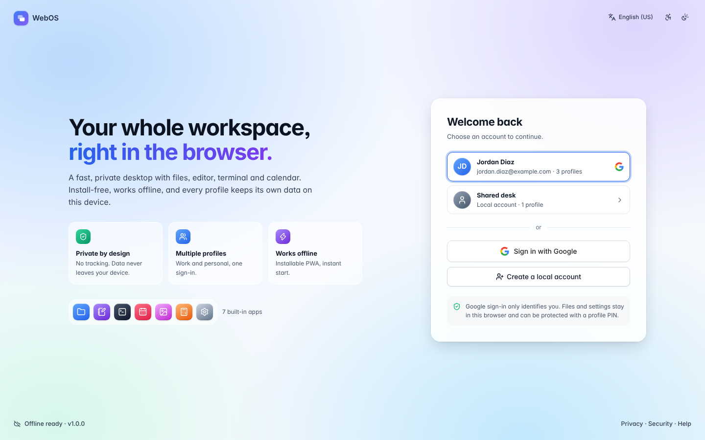

### 02 · Profile picker
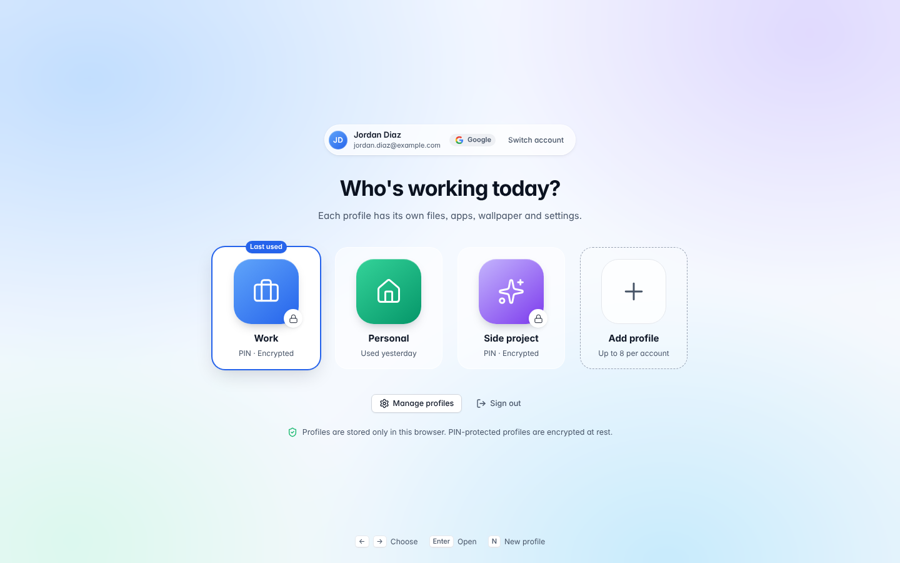

### 03 · Lock screen
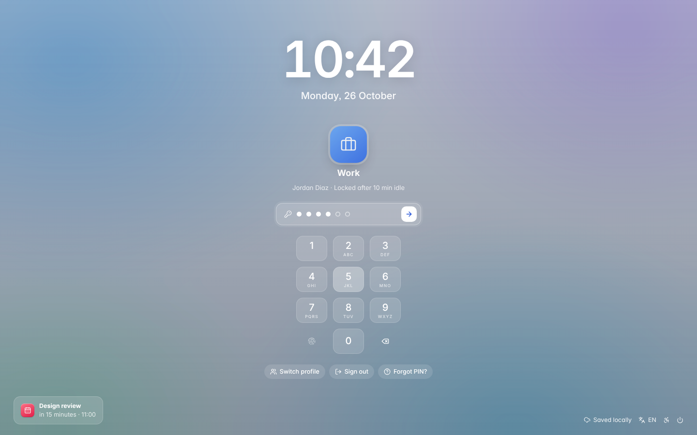

### 04 · Desktop (first run)
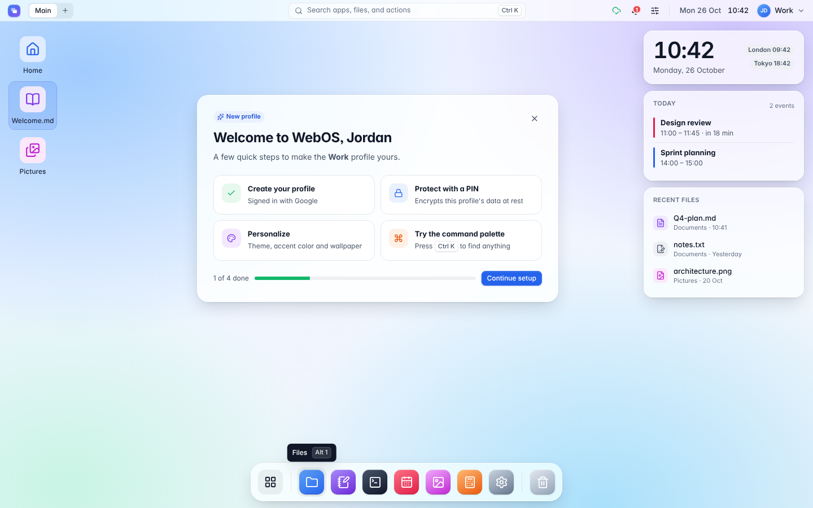

### 05 · Multitasking with snap layouts
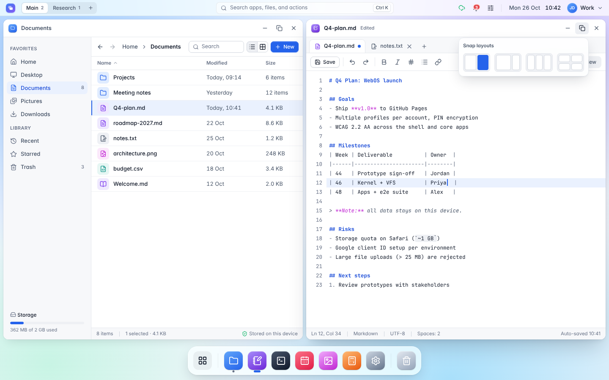

### 06 · Command palette
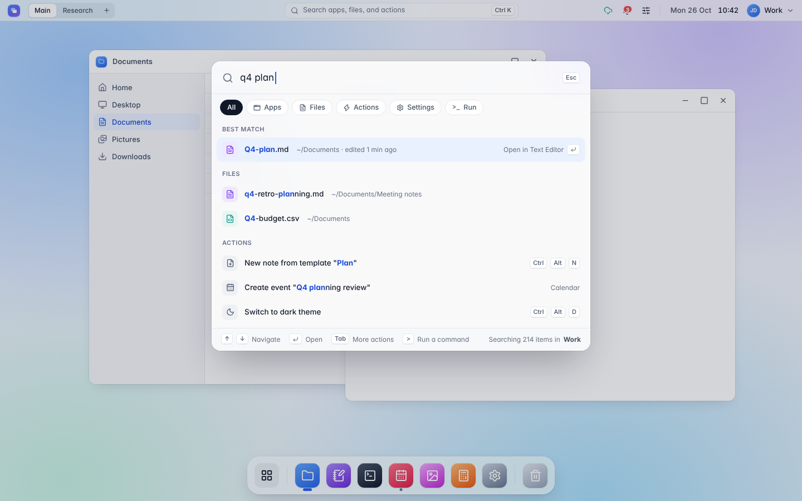

### 07 · Launcher
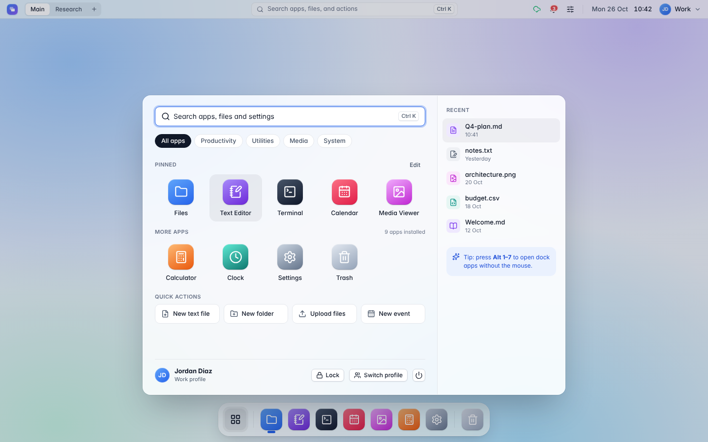

### 08 · Quick settings and notifications
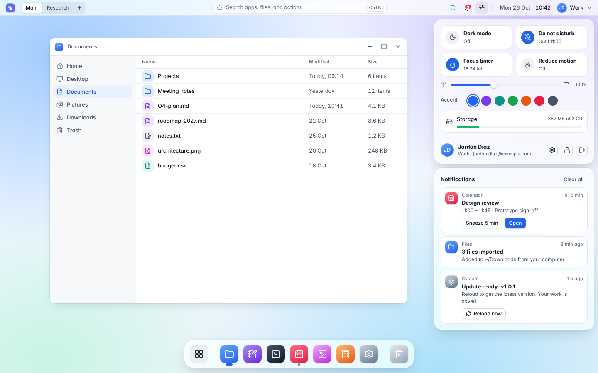

### 09 · Settings
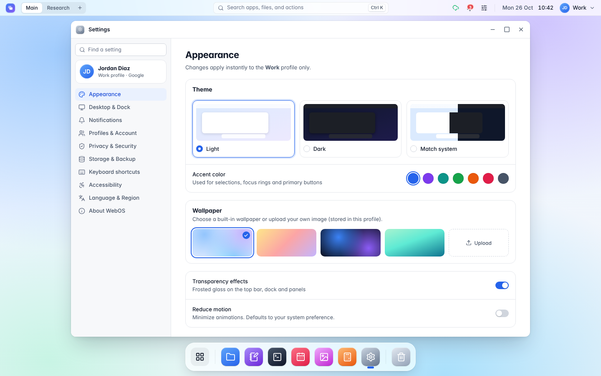

### 10 · Terminal and Calendar
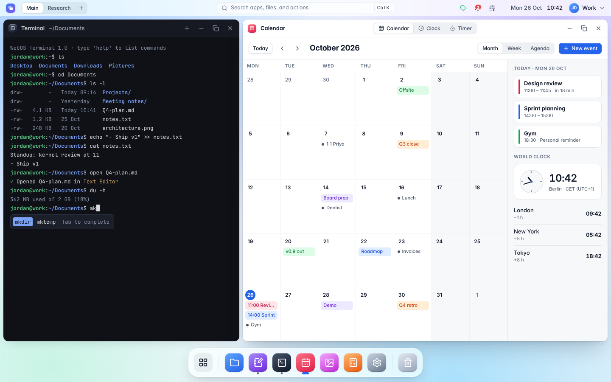

### 11 · Media viewer and Markdown preview
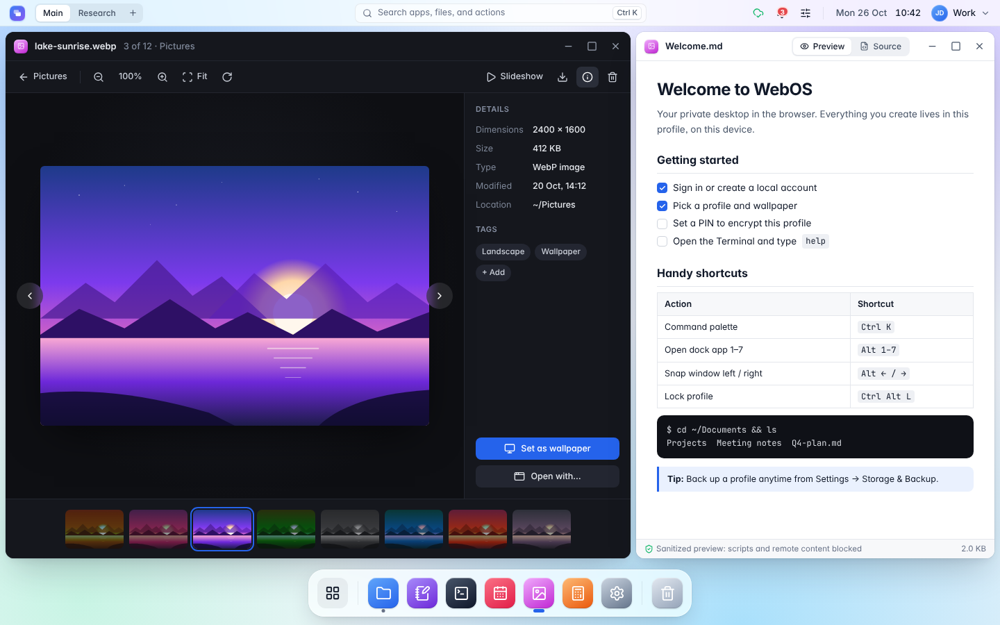

### 12 · Dark mode
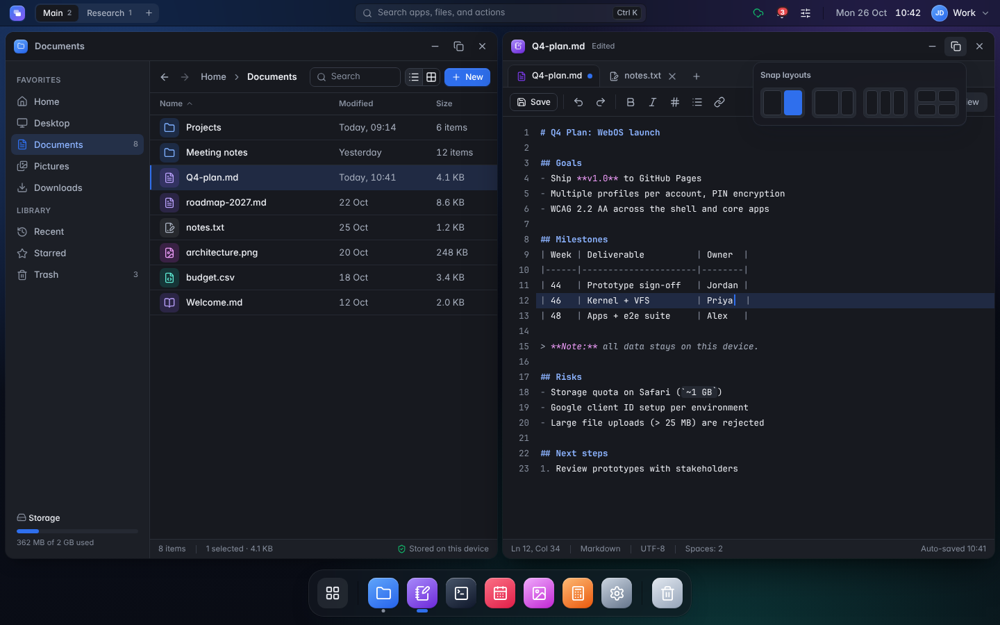

### 13 · Mobile
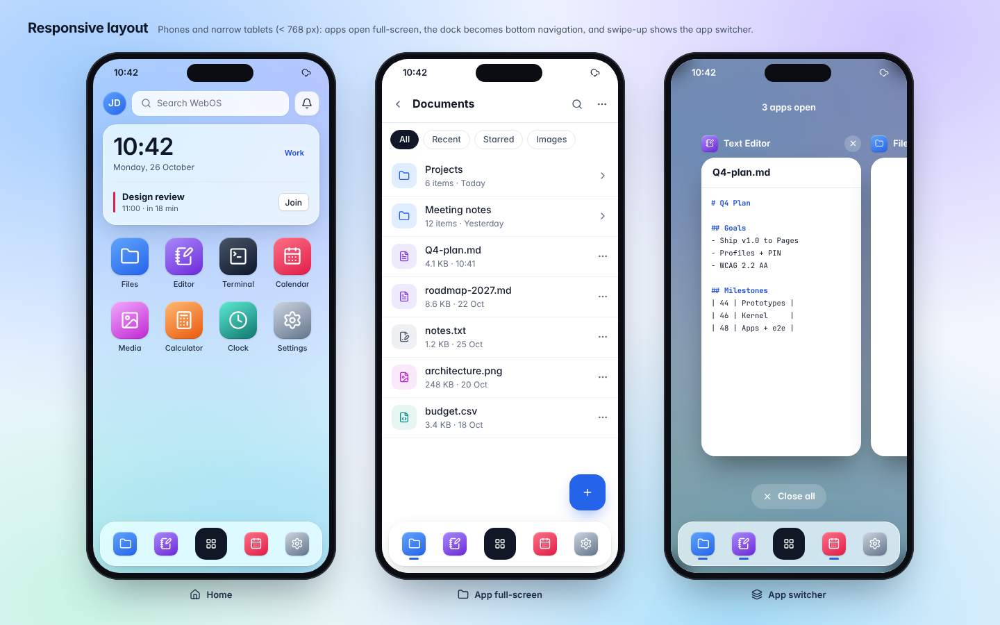
